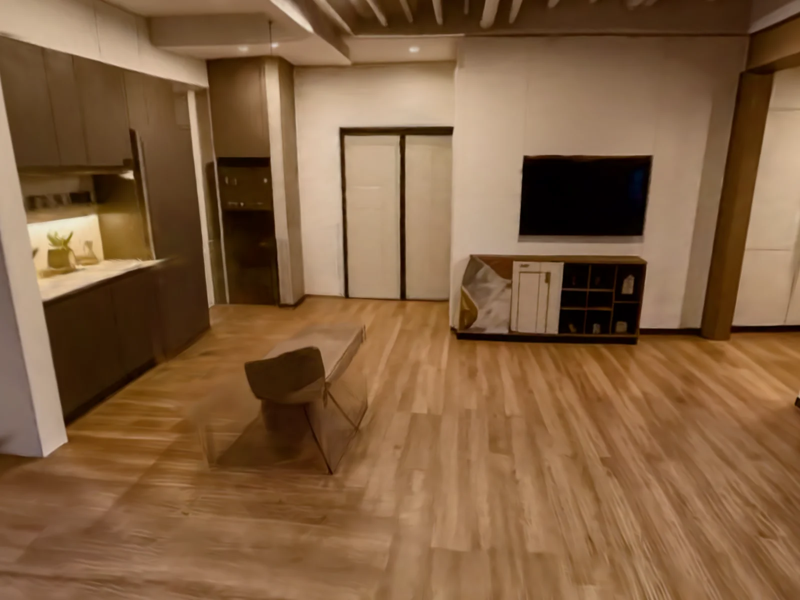
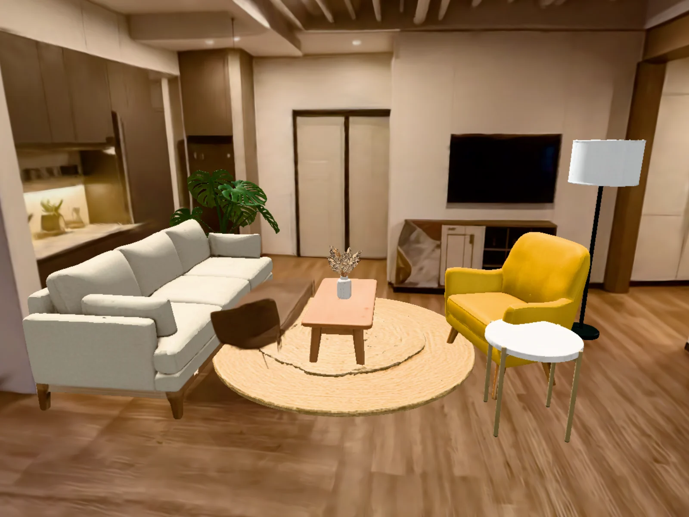
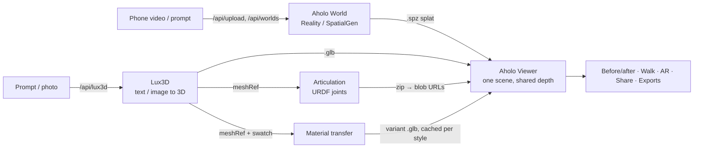

<p align="center">
  
</p>

<p align="center">
  <b>Redesign your real room in 3D, with AI furniture that actually works.</b><br/>
  Scan a room with your phone, add furniture you describe or photograph, open its doors and drawers, and restyle everything in one tap.
</p>

<p align="center">
  <a href="https://reroom.adoranto737.workers.dev"><b>Live demo</b></a> ·
  <a href="#quick-start">Quick start</a> ·
  <a href="#built-on-aholo">Built on Aholo</a> ·
  <a href="#how-it-works">How it works</a> ·
  <a href="reroom-docs/README.md">Product docs</a>
</p>

---

<table>
  <tr>
    <td width="50%"></td>
    <td width="50%"></td>
  </tr>
  <tr>
    <td align="center"><sub>Before: a 3D Gaussian-splat room from Aholo World</sub></td>
    <td align="center"><sub>After: furnished in ReRoom with Lux3D pieces, same camera</sub></td>
  </tr>
</table>

ReRoom is our entry for the **Manycore Aholo Global 3D AI Hackathon** (*Play in 3D, Create with Aholo*). It is built as a real, launchable product.

## What you can do

| | |
|---|---|
| **Scan** | Upload a 30–60 s phone video (MP4/MOV) or an Insta360 `.insv`. Aholo Reality reconstructs it as a photoreal 3D Gaussian-splat room. |
| **Dream** | No room handy? Describe one in a sentence. Aholo SpatialGen builds a walkable room in about ten minutes. |
| **Create** | Add pieces from a 24-item library, **describe anything** in words, or **snap a product photo**. Lux3D builds it with PBR materials at real size. |
| **Open** | Wardrobes, drawers, fridges and lids really move. Lux3D articulation finds the joints, and ReRoom drives them in the browser. Generated pieces can get moving parts too. |
| **Restyle** | 8 styles (Japandi, Scandinavian, Industrial, Mid-century, Boho, Cyberpunk, Coastal, Luxury) plus *Style Roulette*. Lux3D material transfer re-finishes every piece, cached per style. Or use any material photo. |
| **Walk** | Orbit, top-down, or first-person walk at eye height. Day, evening and night lighting moods. |
| **Compare** | Before/after slider from the same camera, saved as a PNG. |
| **Share & take it with you** | View-only share links (the design lives in the link, nothing stored), a 10-second tour video, phone AR (Quick Look / Scene Viewer) via QR, and GLB / USDZ / STL / 3MF / OBJ / FBX exports for printing and DCC tools. |

## Status

Honest state of the hackathon build (18 Nov 2026):

| | Feature | How it was verified |
|---|---|---|
| ✅ | Aholo Viewer renders splat rooms and Lux3D GLBs in one depth buffer | Furniture is correctly occluded by the splat floor |
| ✅ | SpatialGen dream rooms | 3 rooms generated and shipped as samples (about 10 min each) |
| ✅ | Text → 3D, photo → 3D | Live runs through `/api/lux3d`, loaded in the studio via the proxy |
| ✅ | Articulation | All 7 seed pieces (wardrobe, drawers, sideboard, nightstand, fridge, laptop, box) plus a live-generated cabinet, opened in one scene |
| ✅ | Material transfer restyle | Pre-baked variants for 3 styles, a live restyle from the style bar, material from a photo (API) |
| ✅ | Multi-format export, AR page | USDZ and STL returned for a library model; `/ar` renders at the studio size (checked on desktop, not yet on a phone) |
| ✅ | Editor: drag, rotate, duplicate, delete, undo, double-click open, walk, top, before/after, calibrate, roulette, share → `/view` | Driven with real pointer and keyboard events in Playwright |
| ✅ | Production build, typecheck, lint, `pnpm test` | Pass |
| ⚠️ | Reality reconstruction from a phone video | Wired end to end through `/scan` (upload → `reconstructions.create` → status). A 24 s synthetic test video was accepted, then marked `FAILED` after about 9 s. A real 30–60 s phone walkthrough is still needed. |
| ✅ | Cloudflare deploy | Live on Workers (OpenNext). A live restyle, the proxy and a 55 MB upload were run against the deployed site |
| ⚠️ | Scan upload size | Uploads are buffered by the Worker (128 MB memory), so the deployed site accepts videos up to 60 MB. Locally the cap is 500 MB. |
| ⚠️ | Live results | Aholo result URLs expire after about 2 h. Generated pieces in a saved design or share link stop loading after that; the seed library is stored in the repo. |
| ⏳ | Part split editing UI | API route only |

## Built on Aholo

Nine of these capabilities are in the studio today; part split is server-only for now. The API key stays on the server.

| Aholo capability | SDK call | What it does in ReRoom |
|---|---|---|
| **World · Reality** | `world.reconstructions.create` | Phone or Insta360 video becomes a 3DGS room (`/scan`) |
| **World · SpatialGen** | `world.generations.create` | A sentence becomes a dream room; the three sample rooms were made this way |
| **Asset** | `asset.uploadBuffer` | Uploads scans, photos, library models and material swatches |
| **Aholo Viewer** | `@manycore/aholo-viewer` | Renders splat rooms **and** GLB furniture in one depth buffer (walls and floors occlude furniture correctly) |
| **Lux3D text-to-3D** | `lux3d.textTo3d.create` | "Describe a piece" (G1-Turbo, PBR, AI-predicted real size) |
| **Lux3D image-to-3D** | `lux3d.imgTo3d.create` | "Snap a photo" |
| **Lux3D articulation** | `lux3d.articulationAnimation.create` | Returns a URDF (links + revolute/prismatic joints); `Engine.loadUrdf` animates it |
| **Lux3D material transfer** | `lux3d.materialTransfer.create` | Whole-room restyle and "material from a photo" |
| **Lux3D multi-format export** | `lux3d.multiFormatExport.create` | USDZ (AR), STL/3MF (3D printing), OBJ/FBX |
| **Lux3D part split** | `lux3d.partSplit.create` | Server API (`/api/lux3d`, `op: "split"`). The per-part editing UI is next. |
| **Lux3D tasks** | `lux3d.tasks.retrieve` | Polled by the browser through `/api/lux3d/:taskId` |

Verified method names, parameters, output formats and measured credit costs are in [`reroom-docs/api-notes.md`](reroom-docs/api-notes.md).

## How it works



- **Stateless server.** Each Lux3D or World call is *create → return id*. The browser polls `GET /api/lux3d/:id` or `/api/worlds/:id`, so nothing holds a serverless function open and there is no queue or DB to run.
- **One renderer.** `src/lib/viewer/engine.ts` is the only module that touches `@manycore/aholo-viewer`. It loads splats (SPZ/PLY/SOG), GLBs and URDF assemblies, and handles calibration (up-axis, floor height, scale, yaw), floor-plane picking, ray/AABB selection, lighting moods and snapshots.
- **Real size.** Library items scale to catalog dimensions. Generated items keep Lux3D's AI-predicted size. Rugs scale by their longest side and are laid flat.
- **Result URLs expire after about 2 h**, so the seed library is downloaded and optimized at build time (`gltf-transform resize + jpeg`: about 7 MB down to about 1 MB per model), and live results are proxied through an allowlisted `/api/proxy`.
- **Privacy.** Guest designs live in `localStorage`. Share links carry the design in the URL fragment, which never reaches a server. Photos are re-encoded in the browser, which strips EXIF/GPS. Prompts are filtered, and brand names are swapped for generic descriptions.

## Quick start

Requirements: Node 22+, pnpm, and an Aholo **Global** API key from [labs.aholo3d.com](https://labs.aholo3d.com/api-keys).

```bash
pnpm install                 # also patches Aholo Viewer worker URLs (scripts/patch-viewer.mjs)
cp .env.example .env.local   # then set AHOLO_API_KEY (server-only, never commit it)
pnpm dev                     # http://localhost:3000
```

Open `/studio?room=industrial-loft`, or `/studio?demo=1` for demo mode with no live Aholo calls. Everything in the library still works.

### Deploy to Cloudflare Workers

```bash
npx wrangler login
npx wrangler kv namespace create REROOM_BUDGET   # put the id in wrangler.jsonc
pnpm cf:deploy                                   # OpenNext build + wrangler deploy
npx wrangler secret put AHOLO_API_KEY            # once, and again whenever you rotate the key
```

`pnpm cf:preview` runs the same build locally in workerd. The build strips `.env.local` values from the Worker bundle (`scripts/cf-strip-env.mjs`); the key only lives in the Worker secret.
Credit protection on the deployed site: per-IP and site-wide Workers rate-limit bindings (best effort, eventually consistent), a per-isolate window, and a daily task budget in KV.

### Scripts

| Command | What it does |
|---|---|
| `pnpm seed [ids…]` | Generates the furniture library with Lux3D (text-to-3D → optimize → articulation → URDF). Resumable. |
| `tsx --env-file=.env.local scripts/bake-variants.mts japandi,industrial L_SOFA_3 …` | Pre-bakes style variants with material transfer |
| `tsx --env-file=.env.local scripts/gen-world.mts "<prompt>"` | Starts a SpatialGen dream room |
| `node scripts/build-manifest.mjs` | Indexes library models, URDFs, thumbnails and variants (runs before `dev` and `build`) |
| `node scripts/fetch-materials.mjs` | Downloads the CC0 material swatches used as transfer references |
| `pnpm test` | Runs the self-checks for the prompt guard, proxy allowlist, output picking, sizing and share links |

### Environment

| Variable | Where | Purpose |
|---|---|---|
| `AHOLO_API_KEY` | server | Aholo Global key |
| `AHOLO_REGION` | server | `com` (Global) or `cn` |
| `SITE_URL` | build | Public origin, used for OpenGraph URLs |
| `DAILY_TASK_BUDGET` | server (Workers) | Lux3D + World tasks allowed per UTC day on the deployed site (default 300) |
| `NEXT_PUBLIC_UPLOAD_MAX_MB` | build | Scan upload cap (500 locally, 60 on Workers) |
| `REROOM_DEMO_ONLY` | server | `1` disables live generation |

## Project structure

```
src/
  app/                 landing, /studio, /scan, /view (shared), /ar, privacy, terms
  app/api/             lux3d, worlds, upload, proxy, status (+ dev-only render saver)
  components/studio/   Viewport, AddPanel, Inspector, StyleBar, BeforeAfter, ShareDialog, CalibratePanel…
  lib/aholo/           server.ts: the only module that calls Aholo
  lib/viewer/          engine.ts: the only module that calls the Aholo Viewer
  lib/                 store (zustand, undo/redo), pipeline (generate / articulate / restyle / export), share
content/               library.json, styles.json, rooms.json, manifest.json
public/library/        24 Lux3D seed models, 7 URDF articulations, style variants, thumbnails
public/rooms/          3 SpatialGen rooms (.spz + panorama)
scripts/               seed, bake, world, manifest, material and viewer-patch tooling
reroom-docs/           product brief, specs, UX, architecture, plan, submission notes, API notes
```

## Keyboard

`Drag` move · `Q`/`E` rotate 15° (Shift for 5°) · `Double-click` open/close · `Ctrl D` duplicate · `Del` remove · `Ctrl Z` / `Ctrl Shift Z` undo/redo · `WASD` walk

## Credits

- [Aholo Spatial SDK](https://github.com/manycoretech/aholo-spatial-sdk) and [Aholo Viewer](https://github.com/manycoretech/aholo-viewer) (MIT). `src/lib/viewer/camera-control.ts` is adapted from the Aholo Viewer website.
- Material reference swatches from [ambientCG](https://ambientcg.com) (CC0), listed in `public/materials/CREDITS.txt`.
- AR via [`<model-viewer>`](https://modelviewer.dev) (Apache-2.0).
- Every furniture model and room in this repo was generated with Aholo Lux3D and Aholo World.

## License

[MIT](LICENSE)
